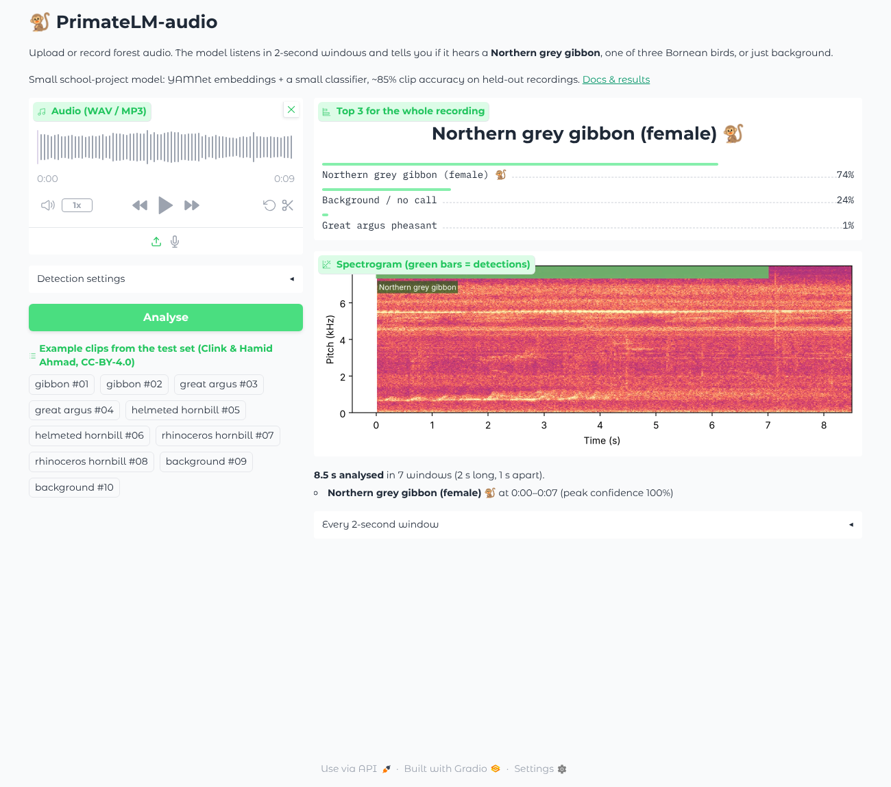

# Interactive Demo

## Try PrimateLM-audio

Upload a recording or use your microphone, and the model tells you whether it hears a gibbon, one of three Bornean birds, or just background.



!!! info "Hosted demo"
    The demo is ready for Hugging Face Spaces (free CPU tier). The steps are in [Deploy to Hugging Face Spaces](#deploy-to-hugging-face-spaces) below. Once our team's Space is live, a "Launch Demo" button will appear here.

## How to use it

1. **Load audio:** upload a WAV, FLAC or MP3 file, record from your microphone, or click one of the 10 example clips (5 the model gets right, 5 it gets wrong).
2. **Press Analyse.**
3. **Top 3:** the three most likely labels for the whole recording, with confidence bars. This is the average over all 2-second windows.
4. **Spectrogram:** a picture of the sound (time left to right, pitch bottom to top, loudness as brightness). Green bars along the top mark detections. Gibbon great calls show up as bright, rising and falling lines around 0.5–1.6 kHz.
5. **Timeline:** for longer recordings, a list like *"Northern grey gibbon at 0:07–0:13"*. A detection needs confidence ≥ 60% in at least 2 windows in a row (adjustable under *Detection settings*).
6. **Every 2-second window:** open this to see the model's answer for each window.

!!! tip "Use WAV or FLAC if you can"
    MP3 compression measurably changes the model's scores (see [Usage](usage.md#limits-please-read)).

## Run it on your laptop

```bash
pip install -r demo/requirements.txt
python demo/app.py
```

Open <http://127.0.0.1:7860>. The first start downloads YAMNet's weights (15 MB). Microphone recording works on `localhost` and on Hugging Face (browsers only allow the mic on secure pages).

## Deploy to Hugging Face Spaces

1. Create a free account at [huggingface.co](https://huggingface.co) and a **New Space** (SDK: *Gradio*, hardware: *CPU basic*).
2. Build the Space folder and upload it:

```bash
python demo/prepare_space.py
pip install huggingface_hub
huggingface-cli login
huggingface-cli upload <your-username>/PrimateLM-audio build/space . --repo-type=space
```

The Space installs `requirements.txt`, downloads YAMNet on first start, and runs `demo/app.py`. Build takes a few minutes. On our 4-core test machine the model needs about 0.1 s for a 10-second clip and 0.25 s for a minute of audio (plus drawing the spectrogram); the free 2-core Space will be somewhat slower.
