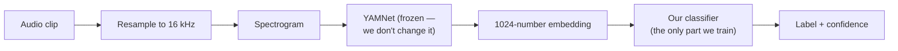

# How It Works

This page explains the model for someone who knows Python but not machine learning.

## The big idea: reuse a model that already understands sound

Training an audio model from scratch needs millions of clips and a lot of GPU time. Instead we use **transfer learning**:

1. A big model that someone else already trained on lots of audio turns each clip into an **embedding** — a list of 1,024 numbers that describes what the sound is like.
2. We train a **small classifier** that learns which embeddings belong to which primate. This takes seconds on a laptop.

## Step by step

**1. Resample to 16 kHz.** Recorders use different sample rates (44.1 kHz, 48 kHz, …). YAMNet expects 16,000 samples per second, so we convert everything to that.

**2. Spectrogram.** A spectrogram shows how much energy there is at each pitch over time. YAMNet computes a *log-mel* spectrogram internally, which spaces pitches the way human hearing does.

**3. YAMNet embeddings.** YAMNet is a small neural network (about 3.7 million parameters) from Google, trained on AudioSet — over 2 million YouTube clips labelled with 521 sound types, including animal sounds. For every ~1 second of audio it outputs 1,024 numbers. For a 2-second clip we average those vectors into one.

**4. Classifier.** We train two simple models and keep the one that scores better on the validation set:

- **Logistic regression** — draws straight-line boundaries between classes in the 1,024-number space.
- **A small MLP** (multi-layer perceptron) — one hidden layer, so it can learn curved boundaries.

## Why YAMNet (and not PANNs or BEATs)?

| | YAMNet | PANNs (CNN14) | BEATs |
|---|---|---|---|
| Size | ~3.7M parameters | ~80M | ~90M |
| Runs fast on a laptop CPU | ✅ | ⚠️ slower | ⚠️ slower |
| Runs on a Raspberry Pi 4 | ✅ (TFLite) | ⚠️ heavy | ❌ impractical |
| Native sample rate | 16 kHz | 32 kHz | 16 kHz |

YAMNet is the only one that comfortably runs on both the laptop **and** the robot, which matters because we want the *same* model everywhere. The trade-off: bigger models like BEATs usually give better embeddings for animal sounds, so our accuracy is probably lower than a research system's.

## Train / validation / test split

- **Train (70%)** — the classifier learns from these.
- **Validation (15%)** — used to pick between logistic regression and the MLP and their settings.
- **Test (15%)** — touched **once**, at the end, to produce the numbers we report. If we tuned on the test set, our numbers would be too optimistic.

Clips cut from the *same* original recording are kept in the same split where the dataset tells us the source recording, so the model can't "cheat" by recognising a recording's background hiss.

## Evaluation metrics

- **Accuracy** — fraction of test clips labelled correctly. Misleading when classes are unbalanced.
- **F1 score (per class)** — balances *precision* (when it says "gibbon", how often is it right?) and *recall* (of all real gibbon clips, how many did it find?).
- **Confusion matrix** — a grid showing, for each true class, what the model predicted. Mistakes are off the diagonal.

Results are published on this page after training.
