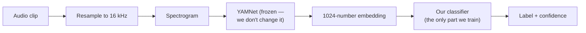
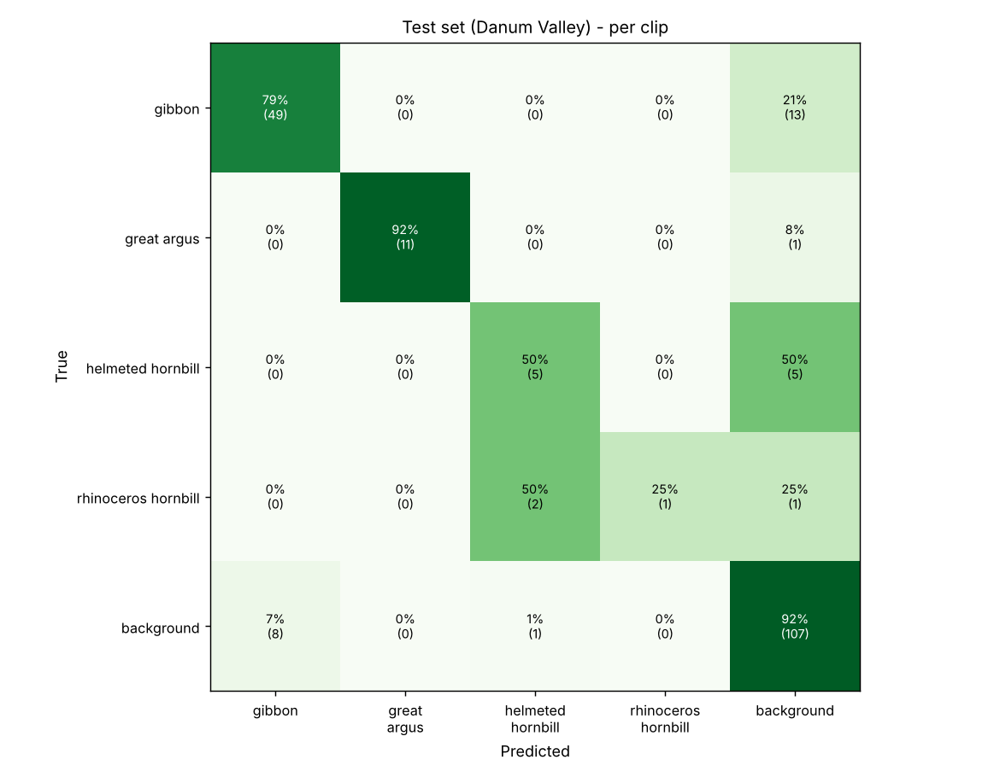
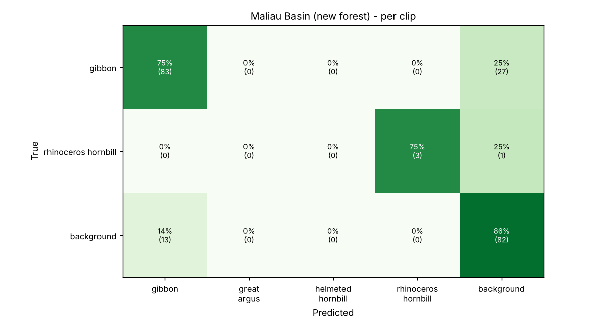

# How It Works

This page explains the model for someone who knows Python but not machine learning.

## The big idea: reuse a model that already understands sound

Training an audio model from scratch needs millions of clips and a lot of GPU time. Instead we use **transfer learning**:

1. A big model that someone else already trained on lots of audio turns each clip into an **embedding** — a list of 1,024 numbers that describes what the sound is like.
2. We train a **small classifier** that learns which embeddings belong to which primate. This takes seconds on a laptop.

## Step by step

**1. Resample to 16 kHz.** Recorders use different sample rates (44.1 kHz, 48 kHz, …). YAMNet expects 16,000 samples per second, so we convert everything to that.

**2. Spectrogram.** A spectrogram shows how much energy there is at each pitch over time. YAMNet computes a *log-mel* spectrogram internally, which spaces pitches the way human hearing does.

**3. YAMNet embeddings.** YAMNet is a small neural network (about 3.7 million parameters) from Google, trained on AudioSet — over 2 million YouTube clips labelled with 521 sound types, including animal sounds. For every ~1 second of audio it outputs 1,024 numbers. For a 2-second clip we average those vectors into one.

**4. Classifier.** We train two simple models and keep the one that scores better on the validation set:

- **Logistic regression** — draws straight-line boundaries between classes in the 1,024-number space.
- **A small MLP** (multi-layer perceptron) — one hidden layer, so it can learn curved boundaries.

## Why YAMNet (and not PANNs or BEATs)?

| | YAMNet | PANNs (CNN14) | BEATs |
|---|---|---|---|
| Size | ~3.7M parameters | ~80M | ~90M |
| Runs fast on a laptop CPU | ✅ | ⚠️ slower | ⚠️ slower |
| Runs on a Raspberry Pi 4 | ✅ (TFLite) | ⚠️ heavy | ❌ impractical |
| Native sample rate | 16 kHz | 32 kHz | 16 kHz |

YAMNet is the only one that comfortably runs on both the laptop **and** the robot, which matters because we want the *same* model everywhere. The trade-off: bigger models like BEATs usually give better embeddings for animal sounds, so our accuracy is probably lower than a research system's.

## Train / validation / test split

- **Train (70%)** — the classifier learns from these.
- **Validation (15%)** — used to pick between logistic regression and the MLP and their settings.
- **Test (15%)** — touched **once**, at the end, to produce the numbers we report. If we tuned on the test set, our numbers would be too optimistic.

Clips cut from the *same* original recording are kept in the same split where the dataset tells us the source recording, so the model can't "cheat" by recognising a recording's background hiss.

## Evaluation metrics

- **Accuracy** — fraction of test clips labelled correctly. Misleading when classes are unbalanced.
- **F1 score (per class)** — balances *precision* (when it says "gibbon", how often is it right?) and *recall* (of all real gibbon clips, how many did it find?).
- **Confusion matrix** — a grid showing, for each true class, what the model predicted. Mistakes are off the diagonal.

## Results

These numbers come straight from `model/artifacts/eval_report.md`, written by `python model/train.py`. They are **not** rounded up or cherry-picked.

**Chosen classifier:** a small MLP (one hidden layer of 128 neurons). On the validation set it beat logistic regression (clip macro-F1 0.795 vs 0.766).

### Test set — Danum Valley (same forest as training, different recordings)

| Level | Accuracy | Macro-F1 |
|---|---|---|
| Per clip (average of its 2-s windows) | **0.848** | **0.723** |
| Per 2-second window | 0.805 | 0.680 |

| Class | Precision | Recall | F1 | Test clips |
|---|---|---|---|---|
| Northern grey gibbon (female) | 0.86 | 0.79 | **0.82** | 62 |
| Great argus pheasant | 1.00 | 0.92 | **0.96** | 12 |
| Helmeted hornbill | 0.62 | 0.50 | **0.56** | 10 |
| Rhinoceros hornbill | 1.00 | 0.25 | **0.40** | 4 |
| Background / no call | 0.84 | 0.92 | **0.88** | 116 |

### Extra test — Maliau Basin (a different forest, a year later)

The model never heard this forest. Only gibbon, rhinoceros hornbill and background clips exist here.

| Level | Accuracy | Macro-F1 |
|---|---|---|
| Per clip | **0.804** | **0.821** |
| Per 2-second window | 0.713 | 0.736 |

| Class | Precision | Recall | F1 | Test clips |
|---|---|---|---|---|
| Northern grey gibbon | 0.86 | 0.75 | **0.81** | 110 |
| Rhinoceros hornbill | 1.00 | 0.75 | **0.86** | 4 |
| Background / no call | 0.75 | 0.86 | **0.80** | 95 |

### What the numbers tell us

- **Gibbons are found most of the time (recall 0.75–0.79), and the model never confuses them with birds.** Its gibbon mistakes are all "background": usually quiet or distant calls.
- **Hornbills are hard.** There are only 50 helmeted and 18 rhinoceros hornbill clips to learn from, and 4–10 to test on, so one mistake moves the score a lot.
- **A new forest costs some accuracy, but not much** for gibbons (F1 0.82 → 0.81). Background is where it drops most: unfamiliar forest sounds get mistaken for calls more often.

### False alarms — important for the robot

A robot listens to background most of the time, so we measured how often a **background** window wrongly triggers a detection:

| Test set | Threshold | False alarms (1 window) | False alarms (2 windows in a row) | Gibbon windows caught |
|---|---|---|---|---|
| Danum Valley | 0.6 | 9.3% | **4.6%** | 70.4% |
| Danum Valley | 0.9 | 5.5% | 2.6% | 59.8% |
| Maliau Basin | 0.6 | 20.0% | **9.9%** | 62.7% |
| Maliau Basin | 0.9 | 10.7% | 4.7% | 48.8% |

Requiring **two windows in a row** halves the false alarms, so the demo and robot do that by default (threshold 0.6). Raise the threshold if your robot reacts too often; lower it if it misses calls.

### Ideas to improve it

- Collect more hornbill (and more primate species) recordings.
- Average *and* max-pool the YAMNet frames, or fine-tune a larger embedding model such as BEATs.
- Add recordings from the robot's own microphone to training, so it learns that mic's sound.
