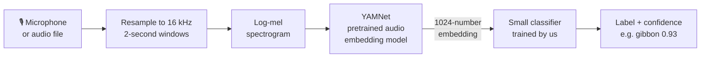

# PrimateLM-audio

[:fontawesome-brands-github: Code](https://github.com/ntoder/PrimateLM-audio){target=_blank} ·
[:material-database: Dataset](datasets.md) ·
[:material-brain: Model](how_it_works.md) ·
[:material-play-circle: Demo](demo.md)

## Updates

  2026-11-24
  Project started. The docs site skeleton is up. Dataset download, training and the live demo are next — see <a href="https://github.com/ntoder/PrimateLM-audio/blob/main/PROGRESS.md">PROGRESS.md</a> for where we are.

## Overview

PrimateLM-audio is a school robotics team project that listens to forest audio and says **which primate is calling, or that no primate is calling**. It is inspired by [NatureLM-audio](https://github.com/earthspecies/NatureLM-audio), a large audio-language model for bioacoustics. We can't train or host a model that big, so we built a small, honest version of the same idea: a pretrained audio model turns sound into numbers, and a small classifier we train ourselves turns those numbers into a label.

Key capabilities:

- **Primate call detection:** tells primate calls apart from other forest sounds and background noise, including a dedicated "no primate" class.
- **Runs on a laptop CPU:** no GPU needed for training or inference; the trained classifier file is small enough to ship with the demo.
- **Long recordings:** a sliding 2-second window turns a long file into a timeline of detections ("gibbon call at 0:04–0:06").
- **Try it in the browser:** a Gradio demo where you upload or record audio and see the spectrogram and top-3 predictions.
- **Robot-ready:** a Raspberry Pi 4 script listens through a USB microphone and publishes detections over stdout, MQTT or HTTP.
- **Honest evaluation:** every number on this site comes from a held-out test set, with per-class scores and a confusion matrix.
