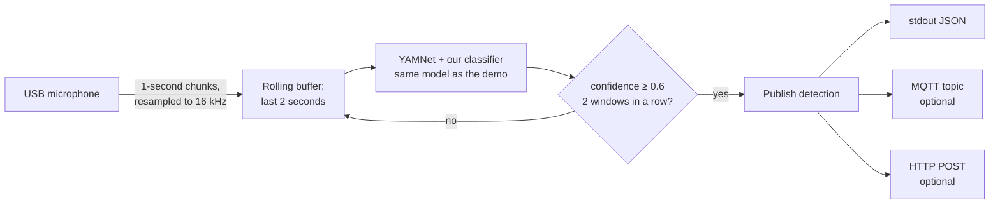

# Robot Integration

We are a robotics team, so the end goal is a robot that **listens to the forest and reacts** when it hears a primate. `robot/live_detect.py` does the listening part. It runs on a Raspberry Pi 4 using only the CPU.

## How it works



Every second, a new 1-second chunk arrives and the oldest second is dropped. The model then classifies the latest 2 seconds, giving 2-second windows with 50% overlap. A call is announced once (`"event": "start"`) when it has been heard in 2 windows in a row, and closed (`"event": "end"`) when it stops.

## Hardware

| Part | Notes |
|---|---|
| Raspberry Pi 4 (2 GB+ RAM) | CPU only. TensorFlow needs a **64-bit** OS. |
| USB microphone | Any class-compliant USB mic. Most only do 44.1/48 kHz; the script resamples to 16 kHz. |
| Raspberry Pi OS Bookworm (64-bit) | Ships Python 3.11, matching the rest of the project. |

## Install on the Pi

```bash
sudo apt install -y libportaudio2 git
git clone https://github.com/ntoder/PrimateLM-audio.git
cd PrimateLM-audio
python3 -m venv .venv
source .venv/bin/activate
pip install -r robot/requirements.txt
```

The trained classifier is already in the repo (`model/artifacts/classifier.joblib`, 1.5 MB). YAMNet's weights (15 MB) download automatically on the first run. The robot doesn't need the dataset.

## Run it

Find your microphone's device number:

```bash
python robot/live_detect.py --list-devices
```

Listen (replace `1` with your device number; `-v` prints every window):

```bash
python robot/live_detect.py --device 1 -v
```

**No microphone? Simulate one with a file.** This works on any laptop and is how we tested it:

```bash
python robot/live_detect.py --wav demo/examples/01_gibbon.flac -v
```

Add `--realtime` to feed the file at real speed (one chunk per second).

### Sending detections to the rest of the robot

```bash
# MQTT (e.g. a Mosquitto broker on the Pi: sudo apt install mosquitto)
python robot/live_detect.py --device 1 --mqtt localhost --mqtt-topic primatelm/detections

# HTTP: POST each detection as JSON to your own server
python robot/live_detect.py --device 1 --http http://192.168.1.20:8000/detections
```

Both can be used at the same time. A network error is logged but never stops the detector.

## Detection messages

One JSON object per line on stdout (status messages go to stderr, so you can pipe stdout straight into another program):

```json
{"event": "start", "time": "2026-11-25T14:51:51", "label": "gibbon", "name": "Northern grey gibbon (female) 🐒", "confidence": 0.999, "window_start_s": 10.0, "window_end_s": 12.0}
{"event": "end", "time": "2026-11-25T14:51:51", "label": "gibbon", "confidence": 0.999, "start_s": 9.0, "end_s": 13.0}
```

`window_start_s` / `start_s` / `end_s` count seconds since the script started listening. `label` is one of `gibbon`, `great_argus`, `helmeted_hornbill`, `rhinoceros_hornbill`.

## What we tested (and what we didn't)

| Test | Result |
|---|---|
| WAV file → stdout | ✅ Works. A gibbon call placed at 6.6–16.6 s in a 24 s file was reported at 9–13 s, with no false alarms. |
| HTTP POST | ✅ Both events arrived at a local test server. |
| MQTT | ✅ Both events arrived at a subscriber through a local test broker. |
| Speed (x86 laptop CPU) | ~90 ms per 2-second window, well within the 1-second budget. |
| Speed on a Raspberry Pi 4 | ⚠️ Not measured yet. We expect it to be several times slower than a laptop but still under 1 second per window. Check the `(… ms)` numbers that `-v` prints. |
| Real USB microphone | ⚠️ Not tested yet (no audio hardware in our build machine). |

### A 48-second test from a forest the model never heard

We joined 6 clips from the Maliau Basin test set: background at 0–24 s, **a gibbon call at 24–32 s**, then background at 32–48 s.

| Settings | Detections | Correct? |
|---|---|---|
| Default (threshold 0.6, 2 windows) | gibbon 1–9 s, great argus 10–13 s, **gibbon 26–32 s** | 1 real, 2 false alarms |
| Threshold 0.9, 2 windows | gibbon 2–6 s, **gibbon 26–32 s** | 1 real, 1 false alarm |
| Threshold 0.6, 3 windows | gibbon 1–9 s, **gibbon 26–32 s** | 1 real, 1 false alarm |

The real call is always found. The model is very sure (up to 100%) about the 1–9 s "background" clip. That clip may contain a faint, distant gibbon that the labeller filed as noise, or it may be a plain mistake. We can't tell from the audio alone.

!!! tip "Tuning for your robot"
    False alarms are the main problem in a new place (about 10% of background windows in Maliau, see [How It Works](how_it_works.md#false-alarms-important-for-the-robot)). If the robot reacts too often, use `--threshold 0.9`. If it needs to be really sure before doing something expensive (like driving toward the sound), also add `--min-windows 3`. The best fix is to record a few minutes at the robot's real location and add them to the training data.
