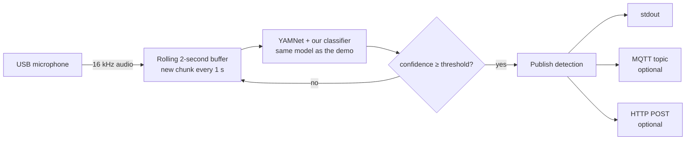

# Robot Integration

We are a robotics team, so the end goal is a robot that **listens to the forest and reacts** when it hears a primate. The `robot/` folder contains a script that does the listening part on a Raspberry Pi 4.

## How it works



## Hardware

| Part | Notes |
|---|---|
| Raspberry Pi 4 (2 GB+ RAM) | Runs everything on CPU. |
| USB microphone | Any class-compliant USB mic. Check it with `arecord -l`. |
| 64-bit Raspberry Pi OS | Needed for the Python audio and ML packages. |

## Detection message format

Each detection is one JSON line, so other robot code can read it easily:

```json
{"time": "2026-11-24T14:03:07", "label": "gibbon", "confidence": 0.91, "window_start_s": 12.0, "window_end_s": 14.0}
```

!!! info "Being built"
    The script (`robot/live_detect.py`) is build step 5. This page will get exact install and run commands, plus a test run against a WAV file, once it is done.
