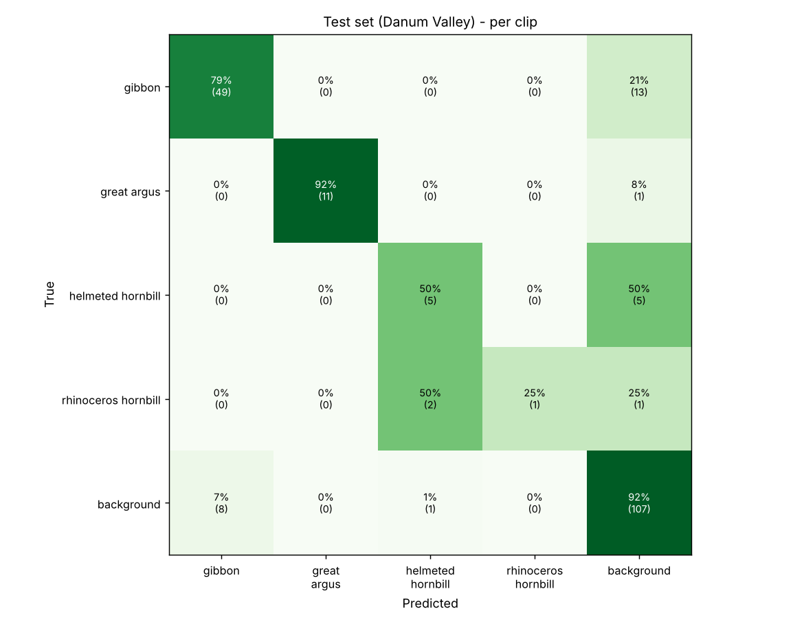
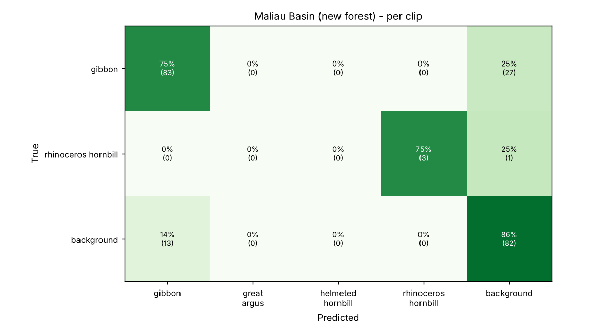

# Evaluation report

Generated by `python model/train.py`. All numbers are on data the model never trained on.

**Chosen model:** `mlp` on top of frozen YAMNet embeddings (2-second windows, 1-second hop).

## Data

Dataset: A labelled dataset of the loud calls of four vertebrates collected using passive acoustic monitoring in Malaysian Borneo - Clink, Dena Jane, Hamid Ahmad, Abdul,
DOI 10.5281/zenodo.14213067, license cc-by-4.0.
Split by recording (no recording appears in two splits). `maliau` is a separate
test set from a different forest, recorded a year later.

| Split | gibbon | great_argus | helmeted_hornbill | rhinoceros_hornbill | background | Clips | Windows |
|---|---|---|---|---|---|---|---|
| train | 310 | 62 | 50 | 18 | 575 | 1015 | 8357 |
| val | 61 | 13 | 10 | 4 | 115 | 203 | 1723 |
| test | 62 | 12 | 10 | 4 | 116 | 204 | 1590 |
| maliau | 110 | 0 | 0 | 4 | 95 | 209 | 1463 |

## Model selection (validation set)

| Model | Clip macro-F1 | Clip accuracy | Window accuracy |
|---|---|---|---|
| logistic_regression | 0.766 | 0.862 | 0.754 |
| mlp | 0.795 | 0.872 | 0.777 |

## Test set - Danum Valley (same forest as training)

| Level | Accuracy | Macro-F1 |
|---|---|---|
| Per clip (average of its windows) | **0.848** | **0.723** |
| Per 2-second window | 0.805 | 0.680 |

Per-class scores (per clip):

| Class | Precision | Recall | F1 | Clips |
|---|---|---|---|---|
| Northern grey gibbon (female) 🐒 | 0.86 | 0.79 | **0.82** | 62 |
| Great argus pheasant | 1.00 | 0.92 | **0.96** | 12 |
| Helmeted hornbill | 0.62 | 0.50 | **0.56** | 10 |
| Rhinoceros hornbill | 1.00 | 0.25 | **0.40** | 4 |
| Background / no call | 0.84 | 0.92 | **0.88** | 116 |

## Extra test - Maliau Basin (new forest, never seen)

Only gibbon, rhinoceros hornbill and background clips exist in this set.

| Level | Accuracy | Macro-F1 |
|---|---|---|
| Per clip | **0.804** | **0.821** |
| Per 2-second window | 0.713 | 0.736 |

| Class | Precision | Recall | F1 | Clips |
|---|---|---|---|---|
| Northern grey gibbon (female) 🐒 | 0.86 | 0.75 | **0.81** | 110 |
| Rhinoceros hornbill | 1.00 | 0.75 | **0.86** | 4 |
| Background / no call | 0.75 | 0.86 | **0.80** | 95 |

## Detection settings (for the demo and robot)

Share of BACKGROUND 2-second windows that would wrongly trigger a detection, and
share of gibbon windows that are caught, at each confidence threshold.

| Test set | Threshold | False alarms (1 window) | False alarms (2 in a row) | Gibbon windows caught |
|---|---|---|---|---|
| test | 0.6 | 9.3% | 4.6% | 70.4% |
| test | 0.8 | 6.7% | 3.1% | 64.5% |
| test | 0.9 | 5.5% | 2.6% | 59.8% |
| maliau | 0.6 | 20.0% | 9.9% | 62.7% |
| maliau | 0.8 | 14.0% | 6.2% | 55.8% |
| maliau | 0.9 | 10.7% | 4.7% | 48.8% |

We use threshold 0.6 with 2 windows in a row by default.

## Caveats

- Window labels are inherited from the clip: a 2-second window inside a "gibbon"
  clip may actually be a pause between calls, so window scores are pessimistic.
- Small classes (rhinoceros hornbill, helmeted hornbill) have few test clips, so
  their scores can swing a lot with one or two mistakes.
- All audio comes from one recorder model in Sabah, Malaysia. Expect lower accuracy
  on phone, zoo or other-region recordings.
